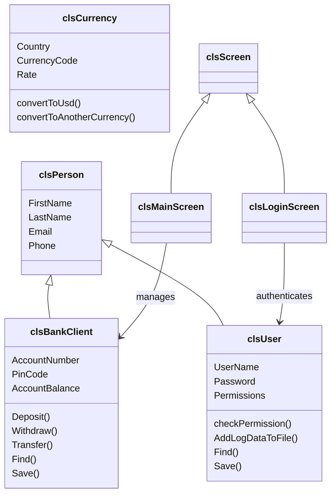

<div align="center">

# 🏦 Bank Management System

**A console-based banking application written in C++ with Object-Oriented Programming.**

Client accounts · Deposits, withdrawals & transfers · Role-based user permissions · Currency exchange · Audit logs


</div>

---

## Table of Contents

- [Overview](#overview)
- [Features](#features)
- [Getting Started](#getting-started)
- [Usage](#usage)
- [Permissions Model](#permissions-model)
- [Architecture](#architecture)
- [Project Structure](#project-structure)
- [Data Files](#data-files)
- [Known Limitations](#known-limitations)
- [Roadmap](#roadmap)
- [Author](#author)

---

## Overview

This project simulates the core workflows of a bank's back office in a lightweight terminal application. Staff sign in with a personal account, and what they can do depends on the permissions an administrator has granted them. Everything is persisted in plain text files, so the program has **no external dependencies** and no database to set up.

It was built to demonstrate clean OOP design in C++: encapsulation, inheritance, static utility classes, a layered screen-based UI, and a simple file-backed persistence layer.

## Features

### Client management
- List, add, update, delete and find clients by account number
- Input validation on all prompts (numeric ranges, existing/duplicate accounts, confirmations)

### Transactions
- **Deposit** and **Withdraw** with a confirmation step and insufficient-funds protection
- **Transfer** between two accounts (self-transfers are blocked, overdrafts are rejected)
- **Total balances** report with the amount spelled out in words
- **Transfer log** recording every transfer with date/time, both accounts, amount, resulting balances, and the user who performed it

### User administration
- List, add, update, delete and find system users
- Fine-grained, bitmask-based permissions per user
- Passwords are not stored as plain text in `Users.txt`

### Security and auditing
- Login with a **3-attempt limit**, after which the system locks and exits
- **Access-denied screen** whenever a user opens a feature they don't have permission for
- **Login record** — every successful login is appended to `log.txt`

### Currency exchange
- List all currencies, find by code or country
- Update a currency's exchange rate (USD-based)
- Currency calculator that converts between any two currencies via USD

## Getting Started

### Prerequisites

| Requirement | Notes |
|---|---|
| **Windows** | The UI uses `system("cls")` and `system("pause")` |
| **MSVC** (Visual Studio 2019 or newer) | The code uses `__declspec(property)`, an MSVC extension, so GCC/MinGW will not compile it as-is |
| C++14 or newer | |

### Build and run with Visual Studio

1. Clone the repository
   ```bash
   git clone https://github.com/amive/Bank-System-Using-OOP-CPP.git
   cd Bank-System-Using-OOP-CPP
   ```
2. Create a new **Empty C++ Console Project** in Visual Studio and add all files from the repository folder (`Bank System.cpp` is the entry point).
3. Build and run the project.

### Build from the command line

From a **Developer Command Prompt for VS**, inside the repository folder:

```bat
cl /EHsc /std:c++17 "Bank System.cpp" /Fe:BankSystem.exe
BankSystem.exe
```

> **Important:** the program reads and writes its data files using relative paths (`Clients.txt`, `Users.txt`, …). Always run the executable from the folder that contains them.

## Usage

1. Start the program and sign in with a user defined in `Users.txt`. You have 3 attempts.
2. The **Main Menu** is shown:

```text
 [1] Show Client List
 [2] Add New Client
 [3] Delete Client
 [4] Update Client Info
 [5] Find Client
 [6] Transactions
 [7] Manage Users
 [8] Login Record
 [9] Currency Exchange
 [0] Logout
```

3. Some options open a sub-menu:

| Transactions | Manage Users | Currency Exchange |
|---|---|---|
| Deposit | List Users | List Currencies |
| Withdraw | Add New User | Find Currencies |
| Total balances | Delete User | Update Rate |
| Transfer | Update User | Currency Calculator |
| Transfer log | Find User | Main Menu |
| Main menu | Main Menu | |

Logging out returns to the login screen.

## Permissions Model

Each user stores a single integer in `Users.txt`. Each feature is one bit, so permissions can be combined by adding (or OR-ing) values together. A value of **`-1`** grants full access.

| Permission | Value |
|---|---:|
| Show client list | 1 |
| Add new client | 2 |
| Delete client | 4 |
| Update client | 8 |
| Find client | 16 |
| Transactions | 32 |
| Manage users | 64 |
| Login record | 128 |
| Currency exchange | 256 |
| **All (full access)** | **-1** |

**Example:** a teller who can list clients, find clients and use transactions has `1 + 16 + 32 = 49`.

Access is checked with a bitwise AND (`checkPermission`), and users without the right see the *Access Denied* screen.

## Architecture

The code follows a layered design: entity classes handle data and persistence, screen classes handle presentation, and small static utility classes provide shared helpers.



Design notes:

- **Inheritance:** `clsBankClient` and `clsUser` both extend `clsPerson`.
- **Entity modes:** entities carry an internal mode (empty, update, add-new, delete) so a single `Save()` method handles insert, update and delete.
- **Soft delete:** records are flagged for deletion and then skipped when the file is rewritten.
- **Static screens:** every screen is a class of static methods that inherits shared drawing and access-check helpers from `clsScreen`.
- **Session state:** the signed-in user is held in a global `currentUser` (`Global.h`).

## Project Structure

```text
.
├── Bank System.cpp              # Entry point (login loop)
├── Global.h                     # Current signed-in user
│
├── clsPerson.h                  # Base entity
├── clsBankClient.h              # Client entity + transaction logic
├── clsUser.h                    # User entity + permissions
├── clsCurrency.h                # Currency entity + conversion logic
│
├── clsScreen.h                  # Base screen (header, access checks)
├── clsLoginScreen.h             # Authentication
├── clsMainScreen.h              # Main menu & navigation
├── clsClientListScreen.h        # Client screens
├── clsAddNewClientScreen.h
├── clsUpdateClientScreen.h
├── clsDeleteClientScreen.h
├── clsFindClientScreen.h
├── clsTransactionsScreen.h      # Deposit / Withdraw / Transfer / Balances
├── clsTransferRecord.h          # Transfer log viewer
├── clsManageUsers.h             # User administration menu
├── clsListUsersScreen.h         # User screens
├── clsAddNewUserScreen.h
├── clsUpdateUserScreen.h
├── clsDeleteUserScreen.h
├── clsFindUserScreen.h
├── clsLoginRecord.h             # Login history viewer
├── clsCurrencyExchange.h        # Currency menu
├── clsListCurrenciesScreen.h    # Currency screens
├── clsFindCurrencyScreen.h
├── clsUpdateCurrencyRateScreen.h
├── clsCurrencyCalculatorScreen.h
├── clsAccessDeniedScreen.h
├── clsLogout.h
│
├── clsInputValidate.h           # Input helpers
├── clsString.h                  # String helpers
├── clsDate.h                    # Date/time helpers
├── clsUtil.h                    # Encryption, number-to-text, misc.
├── communicationInterface.h     # Communication helpers
│
├── Clients.txt                  # Client records
├── Users.txt                    # User accounts
├── Currencies.txt               # Exchange rates
├── TransferLog.txt              # Transfer history
└── log.txt                      # Login history
```

## Data Files

All files are plain text, one record per line, with fields separated by the delimiter `#//#`.

| File | Fields (in order) |
|---|---|
| `Clients.txt` | First name, Last name, Email, Phone, Account number, PIN, Balance |
| `Users.txt` | First name, Last name, Email, Phone, Username, Password *(encrypted)*, Permissions |
| `Currencies.txt` | Country, Currency code, Currency name, Rate per 1 USD |
| `TransferLog.txt` | Date/time, From account, To account, Amount, Sender balance after, Receiver balance after, Performed by |
| `log.txt` | Date/time, Username, Password *(encrypted)*, Permissions |

**Currency conversion:** an amount is first converted to USD (`amount / rate`) and then to the target currency (`usd × targetRate`).

## Known Limitations

This is an educational project, not production banking software. Worth knowing before building on it:

- **Windows/MSVC only** (`cls`, `pause`, `__declspec(property)`).
- **Flat-file storage:** no concurrency control, transactions or atomic writes. Every operation reloads and rewrites whole files.
- **Passwords use reversible encryption**, not salted hashing, and the encrypted password is also written to `log.txt`.
- **Client PIN codes are stored in plain text** in `Clients.txt`.
- **Balances are stored as floating-point values**, which can introduce rounding error; a fixed-point or integer-cents representation would be safer for money.
- **No automated tests.**

## Roadmap

- [ ] Replace reversible encryption with salted password hashing (e.g. bcrypt/Argon2)
- [ ] Store balances as integer minor units
- [ ] Make the build cross-platform (replace `system("cls")` and MSVC property extensions)
- [ ] Add a CMake build
- [ ] Add unit tests for transactions and permission checks
- [ ] Migrate persistence to SQLite

## Author

**amive** — [github.com/amive](https://github.com/amive)

Contributions, issues and suggestions are welcome. Feel free to open an [issue](https://github.com/amive/Bank-System-Using-OOP-CPP/issues).
